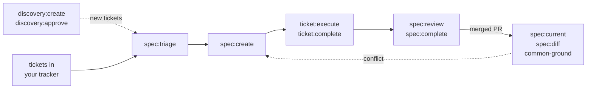

<p align="center">
  
</p>

<p align="center">
<a href="https://trendshift.io/repositories/20667" target="_blank"></a>
<a href="https://github.com/hesreallyhim/awesome-claude-code"></a>
</p>

<p align="center">
  <a href="https://github.com/jeffallan/claude-skills"></a>
  <a href="LICENSE"></a>
  <a href="https://github.com/jeffallan/claude-skills"></a>
  <a href="https://github.com/jeffallan/claude-skills/stargazers"></a>
  <a href="https://github.com/jeffallan/claude-skills/actions/workflows/ci.yml"></a>
</p>

---

## What's New in v0.5.0

v0.5.0 rebuilds the project workflow around specs. Tickets stay in your tracker, specs live as Markdown in your repo, and each ticket is built with its failing test first, by hand or in an unattended goal run.

**Install**
- The plugin now ships from the `plugin/` folder on `main`, listed by the root marketplace entry. The [Quick Start](#quick-start) commands are unchanged. Updating the plugin installs what `main` holds, and the separate `plugin` distribution branch is gone. See [plugin/README.md](plugin/README.md).
- The workflow commands need [uv](https://docs.astral.sh/uv/) and a `.claude/workflow-config.json`, which a setup wizard offers to create. See [Tracker Setup](docs/TRACKER_SETUP.md).

**Adopting an existing codebase**
- `intake` documents the code, pins its current behavior in characterization tests and records each bug it finds as an `F-NNN` finding while leaving the behavior unchanged. It also writes a baseline spec and `docs/system-description.md`, and runs by hand or as one goal with a commit per item. See [Intake](docs/INTAKE.md).

**From tickets to a merged spec**
- `discovery:create` and `discovery:approve` turn rough input into tickets you approve before they reach the tracker. See [Discovery](docs/WORKFLOW_COMMANDS.md#discovery).
- `spec:triage` groups tickets into specs. `spec:create` checks each ticket's readiness against the code, then writes the plan and goal prompt. Specs sit under `docs/specs/{todo,completed}/` with a generated `INDEX.md`. See [Specs](docs/WORKFLOW_COMMANDS.md#specs).
- `ticket:execute` and `ticket:complete` build one ticket test first and commit it with a `Ticket: <id>` trailer. Neither writes to the tracker. See [Tickets](docs/WORKFLOW_COMMANDS.md#tickets).
- `spec:review` runs a reviewer panel over the spec diff and a blind verifier per finding, then a rollup and gate. `spec:complete` opens and merges the PR, closes the tickets, and its `docs:verify` step checks the README and `docs/` for claims the diff made stale, fixing each one only on your yes. `spec:status` shows where every spec stands. See [Review and completion](docs/WORKFLOW_COMMANDS.md#review-and-completion).

**Goal runs and the guard**
- `spec:create` prints launch commands for a goal run over the whole spec or the next batch. The launch denies pushes, PR and issue writes, API writes and questions to you; a stuck ticket is blocked with `guard block` and the run continues. See [Goal Runs](docs/GOAL_RUNS.md).
- The ticket guard ships inside the plugin as `runtime/guard.pyz` and runs through `uv run`. Plugin hooks freeze RED tests, re-run GREEN before a goal run stops and restore ticket context after a compaction. They exit at once unless a ticket is in progress.

**Current state and assumptions**
- `spec:current` checks `docs/system-description.md` against the code and compiles `docs/current-state.json`. `spec:diff [spec ...]` shows what changes if the given specs land in order, with overlaps and each spec's assumptions. See [Current state and assumptions](docs/WORKFLOW_COMMANDS.md#current-state-and-assumptions).
- `common-ground` checks those assumptions against the current state through the `assumption-checker` agent and keeps its ground file in the repo as `docs/COMMON-GROUND.md`. See [Common Ground](docs/COMMON_GROUND.md).

**Agents and trackers**
- Long or parallel work runs in the plugin's agents: `code-reader`, `doc-writer`, `test-writer`, `security-prober`, `architect`, `reviewer`, `verifier` and `assumption-checker`. Agents never commit. See [Agents](docs/WORKFLOW_COMMANDS.md#agents).
- Tracker adapters cover Jira, GitHub Issues, GitHub Projects, Linear and text tickets, plus a GitHub code-host adapter. See [Tracker Setup](docs/TRACKER_SETUP.md).

**Upgrading from 0.4.x**
- The `project:<phase>:<command>` names are gone. Commands are now `discovery:*`, `spec:*` and `ticket:*`, and "spec" replaces "epic".
- `create-implementation-plan` folds into `spec:create` and `complete-epic` into `spec:complete`. `complete-sprint` and the retrospective phase are removed.
- `common-ground` used to keep its file under `~/.claude/common-ground/`. When one exists for the repository, it offers to move those assumptions in.

## Quick Start

```bash
/plugin marketplace add jeffallan/claude-skills
```
**Then, install the skills:**
```bash
/plugin install fullstack-dev-skills@fullstack-dev-skills
```

For all installation methods and first steps, see the [**Quick Start Guide**](QUICKSTART.md).

**Full documentation:** [jeffallan.github.io/claude-skills](https://jeffallan.github.io/claude-skills)

## Skills

<!-- SKILL_COUNT -->71<!-- /SKILL_COUNT --> specialized skills across 12 categories covering languages, backend/frontend frameworks, infrastructure, APIs, testing, DevOps, security, data/ML, and platform specialists.

See [**Skills Guide**](SKILLS_GUIDE.md) for the full list, decision trees, and workflow combinations.

## Usage Patterns

### Context-Aware Activation

Skills activate automatically based on your request:

```bash
# Backend Development
"Implement JWT authentication in my NestJS API"
→ Activates: NestJS Expert → Loads: references/authentication.md

# Frontend Development
"Build a React component with Server Components"
→ Activates: React Expert → Loads: references/server-components.md
```

### Multi-Skill Workflows

Complex tasks combine multiple skills:

```
Feature Development: Feature Forge → Architecture Designer → Fullstack Guardian → Test Master → DevOps Engineer
Bug Investigation:   Debugging Wizard → Framework Expert → Test Master → Code Reviewer
Security Hardening:  Secure Code Guardian → Security Reviewer → Test Master
```

## Context Engineering

Check the assumptions your specs and Claude make against your system's current state with `/common-ground`. See the [**Common Ground Guide**](docs/COMMON_GROUND.md) for full documentation.

## Project Workflow

The <!-- WORKFLOW_COUNT -->13<!-- /WORKFLOW_COUNT --> workflow commands take a group of tickets from your tracker to a reviewed, merged pull request: `spec:triage` groups tickets into specs, `spec:create` plans one, `ticket:execute` and `ticket:complete` build it test-first (by hand or in an unattended goal run), and `spec:review` and `spec:complete` review it and merge it. Specs live as markdown in your repo; tickets stay in Jira, GitHub Issues, GitHub Projects, Linear or text files. See the [**Workflow Commands Reference**](docs/WORKFLOW_COMMANDS.md). `spec:current` and `spec:diff` show the system as it is and what the outstanding specs would change. For an existing codebase, run the `intake` command first. It documents the code, pins its current behavior in tests and tracks its bugs; see [**Intake**](docs/INTAKE.md).



> [!TIP]
> **Setup:** the workflow needs [uv](https://docs.astral.sh/uv/) and a `.claude/workflow-config.json`, which the first command that needs the tracker offers to create. See [**Tracker Setup**](docs/TRACKER_SETUP.md) and [**Goal Runs**](docs/GOAL_RUNS.md).

## Documentation

- [**Quick Start Guide**](QUICKSTART.md) - Installation and first steps
- [**Skills Guide**](SKILLS_GUIDE.md) - Skill reference and decision trees
- [**Workflow Examples**](https://github.com/jeffallan/claude-skills/blob/main/examples/README.md) - Step-by-step multi-skill walkthroughs
- [**Common Ground**](docs/COMMON_GROUND.md) - Context engineering with `/common-ground`
- [**Workflow Commands**](docs/WORKFLOW_COMMANDS.md) - Project workflow commands guide
- [**Tracker Setup**](docs/TRACKER_SETUP.md) - Configure the workflow for your tracker
- [**Intake**](docs/INTAKE.md) - Adopt an existing codebase
- [**Goal Runs**](docs/GOAL_RUNS.md) - Unattended goal runs over a spec
- [**Atlassian MCP Setup**](docs/ATLASSIAN_MCP_SETUP.md) - Atlassian MCP server setup, for Jira
- [**Local Development**](docs/local_skill_development.md) - Local skill development
- [**Contributing**](CONTRIBUTING.md) - Contribution guidelines
- **plugin/skills/\*/SKILL.md** - Individual skill documentation
- **plugin/skills/\*/references/** - Deep-dive reference materials

## Contributing

See [**Contributing**](CONTRIBUTING.md) for guidelines on adding skills, writing references, and submitting pull requests.

## Changelog

See [Changelog](CHANGELOG.md) for full version history and release notes.

## License

MIT License. See the [LICENSE](LICENSE) file for details.

## Support

- **Issues:** [GitHub Issues](https://github.com/jeffallan/claude-skills/issues)
- **Discussions:** [GitHub Discussions](https://github.com/jeffallan/claude-skills/discussions)
- **Repository:** [github.com/jeffallan/claude-skills](https://github.com/jeffallan/claude-skills)

## Author

Built by [**jeffallan**](https://jeffallan.github.io) [](https://www.linkedin.com/in/jeff-smolinski/)

**Principal Consultant** at [**Synergetic Solutions**](https://synergetic.solutions) [](https://www.linkedin.com/company/synergetic-holdings)

Fullstack engineering, security engineering, compliance, and technical due diligence.

## Community

[](https://github.com/Jeffallan/claude-skills/stargazers)

## Star History

[](https://www.star-history.com/#Jeffallan/claude-skills&type=date&legend=top-left)

---

**Built for Claude Code** | **<!-- WORKFLOW_COUNT -->13<!-- /WORKFLOW_COUNT --> Workflows** | **<!-- REFERENCE_COUNT -->393<!-- /REFERENCE_COUNT --> Reference Files** | **<!-- SKILL_COUNT -->71<!-- /SKILL_COUNT --> Skills**
