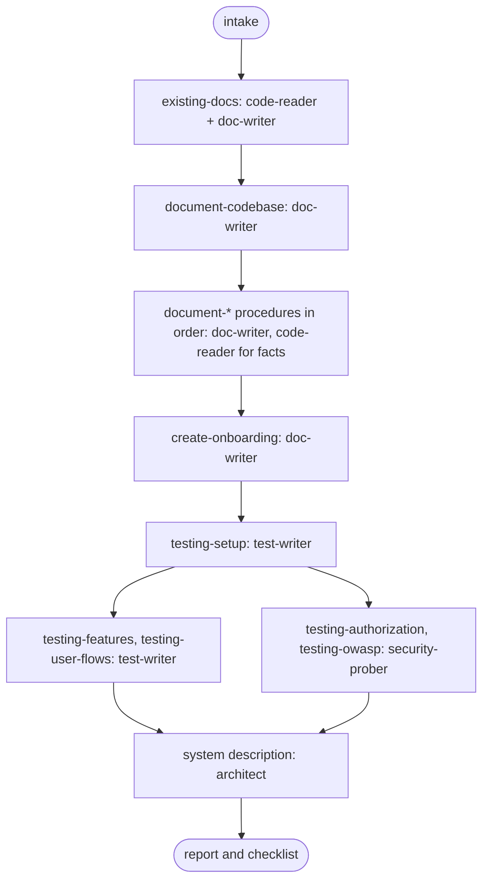
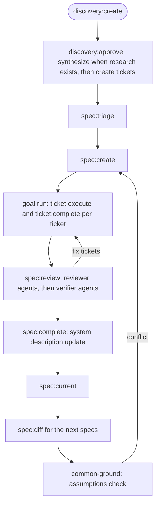

# v0.5.0 restructure plan

Status: design in discussion with the owner, started 2026-11-20. Nothing here is built yet. The release is held for the full scope below, because the restructure breaks command paths anyway.

## Why

The plugin shows 32 slash commands. A user needs about nine of them: run intake once, run the spec loop (triage, create, review, complete, with status now and then), and run discovery when a feature has unknowns. The 21 intake commands are steps the intake run executes, not things a user types, and the review panel's reviewers and verifiers are subagents described only in prose briefs. The restructure makes the menu match how people use it, turns the hidden workers into reusable agents, and gives `common-ground` a real current state to check assumptions against.

## Commands

| Command | Role | Change |
|---------|------|--------|
| `intake` | The one entry point for intake. Orchestrates the intake agents in order and ends with the system description | New; the 21 `intake:*` commands become procedures under `references/intake/` |
| `discovery:create` | Split input into items, read the code, route each item (clear, vague, unknown) | Unchanged |
| `discovery:approve` | The gate to the tracker. When `sources/` holds research and no `synthesis.md` exists, it synthesizes first and shows the result, then resolves blocking decisions and creates the approved tickets | Absorbs `discovery:synthesize` |
| `spec:triage`, `spec:create`, `spec:review`, `spec:status`, `spec:complete` | The spec loop | `spec:review` dispatches the reviewer and verifier agents |
| `spec:current` | What is true now: the system description and docs checked against the code and the completed specs; component status (wired, built but not wired, planned); drift; stale docs | New. Reports what `guard docs-drift` and `guard docs-check` find and adds the architecture view |
| `spec:diff [spec ...]` | What changes if these specs land, in the given order: the current component diagram beside the target, a table per spec, and overlaps where two specs touch the same component or one assumes what another removes. No argument means every outstanding spec | New; replaces `intake:create-system-description --roadmap` |
| `ticket:execute`, `ticket:complete` | One ticket, test first, with the guard's evidence | Kept as commands. Goal runs call them, `spec:status` names the next one, and an attended single-ticket run still writes back to the same plan table. They run in the main session (marker, freeze hooks, one session per ticket), so they can't be agents |
| `common-ground` | Surface assumptions and check them | Reworked: grounded in `spec:current`, and checks the assumptions between `spec:current` and `spec:diff` |

Thirteen commands in the menu, down from 32.

## Agents

Agents are defined by capability, not one per procedure. Each definition fixes tools, model and the kind of work; the orchestrating command names the procedure file and the skills in the brief. Draft set:

| Agent | Does | Typical procedures |
|-------|------|--------------------|
| `code-reader` | Read-only; returns facts with `path::symbol` citations | spec-miner passes in intake, discovery's code read, `spec:current` |
| `doc-writer` | Writes one doc from a procedure and runs its accuracy audit | the `document-*` procedures, onboarding |
| `test-writer` | Characterization and acceptance tests | `testing-setup`, `testing-features`, `testing-user-flows` |
| `security-prober` | Runs the security test procedures | `testing-authorization`, `testing-owasp` |
| `architect` | Component and data-flow views | system description, `spec:current`, `spec:diff` |
| `reviewer` | One review pass over a spec diff | each reviewer row in `spec:review` |
| `verifier` | Decides whether one finding is real, read-only except its scratch worktree | `references/review/verifier.md` |
| `assumption-checker` | Lists and checks assumptions against the current state | `common-ground` |

### Skills chosen at runtime

The skill a task needs is known only at runtime, so agent definitions never hard-code it. The orchestrator picks it when it writes the brief:

- ticket work: the plan's `Skill:` line;
- review: the reviewer table, by what the diff touches;
- intake: the stack it detects, as the "Skills to load" lists do now.

Every brief says "Use the <skill> skill to ...". Every agent ends its report with the skills it loaded, and the orchestrator reruns an agent whose list lacks the skill it was given (the rule `spec:review` already applies to `debugging-wizard`). The evals check it, as the intake scorer's `skills-loaded` check does.

### Constraints to design around

- A subagent can't start subagents. `document-authorization` does today and needs reworking.
- Agents can't ask the owner. Checkpoints stay in the orchestrating command, which runs attended or in goal mode.
- Agents that commit run one at a time.

## Orchestration flows

Each orchestrating command carries a flow diagram the main session follows. Drafts:

## The assumptions loop

1. `spec:current` writes a structured current-state file next to the system description: components with status, flows, open findings, drift.
2. `spec:diff [spec ...]` lists the assumptions each selected spec makes about the current system.
3. `common-ground` checks them against the current state, flags conflicts, and points to `spec:create` to rework the spec that rests on a false assumption.

The ground file moves from `~/.claude/common-ground/<project>/COMMON-GROUND.md` into the repo next to the system description, so it is versioned and shared.

## The guard

The guard stays the authority for evidence: markers, RED and GREEN, the freeze hooks, boundary checks, docs-affected and docs-drift, decisions, the gate. Commands sit on top of it and report what it finds. Nothing in this plan moves a check out of the guard.

## Evals

| Eval | Status |
|------|--------|
| Intake (Timekeeper, dev fixture, holdout) | Exists. Rerun on the new layout |
| Workflow pilots | Exists. Rerun on the new layout |
| Discovery | New: seeded input with gold for routing (clear, vague, unknown), blocking decisions, and approved tickets. Feature Forge interviews need scripted owner answers |
| Common-ground | New: a fixture with a known current state and specs carrying seeded false assumptions; gold for the conflicts. Score recall, false flags, and whether each flag names the right spec |

The 2026-11-20 runs on build 857f8f3 (holdout run 1, the pilot reruns) measure the old layout. They stay as the baseline for comparison.

## Packaging for the official plugin channel

The codebase is restructured so the plugin can ship through Anthropic's official plugin channel, from `main` rather than a `plugin` branch. Related: issues #242, #246 and #247, and the internal "publish from main" to-do. The required layout and checks wait on the owner's feedback from Anthropic.

## What the restructure touches

- `.claude-plugin/plugin.json` command map, and a new agents map
- `commands/`, a new `agents/` folder, `references/intake/` procedures
- goal-prompt templates and launch commands
- scorers that read command paths, and their tests
- `docs/` pages, `docs/workflow/`, `WORKFLOW_COMMANDS.md`, the site sync list
- version and counts (`skill-linter stamp`), the changelog

## Open questions

1. The first agent set: confirm or adjust the eight above.
2. The current-state file's format, which `common-ground` and the evals both read.
3. Packaging requirements from Anthropic's feedback.
4. Order of work: agents and `intake` first, or the assumptions loop first.
