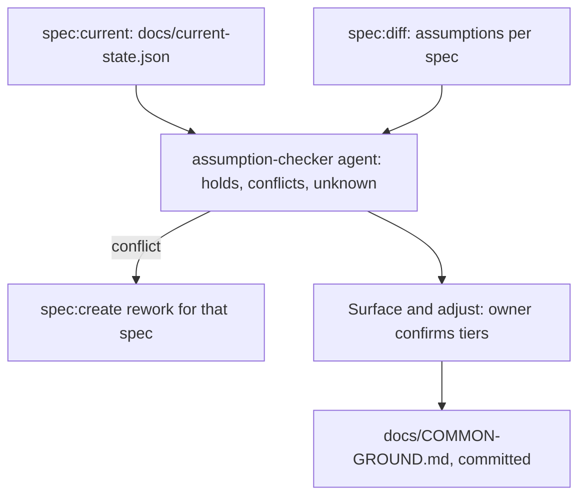

# Common Ground

**Arguments:** $ARGUMENTS

---

## Purpose

Claude often operates on assumptions about project context, technology choices, coding standards, and user preferences. This command surfaces those assumptions for explicit user validation, preventing misaligned work based on incorrect premises.

It is grounded in what `spec:current` compiles: `docs/current-state.json` (components with status, open findings, drift) and `docs/system-description.md`. It checks the assumptions each outstanding spec makes, the ones `spec:diff` lists, against that state, and points to `spec:create` for any spec that rests on a false one.



---

## Argument Parsing

Parse arguments to determine mode:

| Flag | Mode | Description |
|------|------|-------------|
| (none) | Default | Surface & Adjust two-phase interactive flow |
| `--list` | List | Read-only view of all tracked assumptions |
| `--check` | Check | Quick validation of current assumptions |
| `--graph` | Graph | Generate mermaid diagram of reasoning structure |
| `spec ...` | Spec scope | With the default mode or `--check`: check only these specs' assumptions, in this order. Without names, every outstanding spec, as `spec:diff` takes them |

---

## Reference Guide

Load detailed guidance based on context:

| Topic | Reference | Load When |
|-------|-----------|-----------|
| Assumption Types & Tiers | `${CLAUDE_PLUGIN_ROOT}/references/common-ground/assumption-classification.md` | Classifying assumptions, determining type or tier |
| File Management | `${CLAUDE_PLUGIN_ROOT}/references/common-ground/file-management.md` | Storage operations, project ID, ground file format |
| Reasoning Graph | `${CLAUDE_PLUGIN_ROOT}/references/common-ground/reasoning-graph.md` | Using --graph flag, generating mermaid diagrams |
| Spec Assumptions | `${CLAUDE_PLUGIN_ROOT}/references/specs/assumptions.md` | Listing the assumptions outstanding specs make |

---

## Ground File

The ground file lives in the repository next to the system description, so it is versioned and shared: `<docsRoot>/COMMON-GROUND.md` and `<docsRoot>/ground.index.json` (`docsRoot` from `.claude/workflow-config.json`, default `docs`). Every write commits both: `docs(common-ground): <what changed>`.

---

## Spec Assumptions Check

Runs first in the default mode and is the core of `--check`, whenever an outstanding spec exists: any state `guard spec-status` lists but Completed, `Unbranched` (any branch) included, matched by its prefix since the state reads `Unbranched (on <branch>)`. Here `guard` is `uv run -q --no-project --python ">=3.11" "${CLAUDE_PLUGIN_ROOT}/runtime/guard.pyz"`.

1. **Ground it.** Read `docs/current-state.json`. When it is missing, or its `built_at.system_description` doesn't match the `Last updated` SHA in `docs/system-description.md`, stop and suggest `spec:current`: checking against a stale state flags the wrong specs.
2. **List the assumptions** of the specs in scope, in order, with `${CLAUDE_PLUGIN_ROOT}/references/specs/assumptions.md`. Start one `fullstack-dev-skills:code-reader` agent for the list when there are more than three specs.
3. **Check them.** Start one `fullstack-dev-skills:assumption-checker` agent with the list, the path of `docs/current-state.json`, and section 3 of `docs/system-description.md` for flow assumptions:

   ```
   Use the fullstack-dev-skills:architecture-designer skill to check each assumption below against docs/current-state.json; for a flow, section 3 of docs/system-description.md.
   For each, return: ID, holds | conflicts | unknown, the source that settles it, and the spec that rests on it. Write nothing.
   <the assumption table>
   End your report with "Skills loaded: ...".
   ```

4. **Report** in this table, conflicts first, then unknowns, then the rows that hold. The common-ground eval scores this table, so keep its columns:

   ```markdown
   | ID | Verdict | Spec | Assumption | Source | Fix |
   |----|---------|------|------------|--------|-----|
   | billing-v2:A1 | conflicts | billing-v2 | The export worker is wired | components: Exporter (built, not wired) | spec:create billing-v2 |
   ```

   The Fix for a conflict is `spec:create <spec>` to rework the spec, or `spec:current` when the state itself is wrong.

The agent only reads; this session presents the result and asks the owner, because agents can't. A conflict the owner accepts as intended (the spec will change that part of the system) becomes a WORKING assumption in the ground file with the spec named.

---

## Default Mode: Surface & Adjust

When no flags provided, execute the two-phase interactive flow.

### Phase 1: Surface & Select

1. **Analyze current context** to identify assumptions:
   - Run the Spec Assumptions Check above when outstanding specs exist
   - Read `docs/current-state.json` and the system description, and test each surfaced assumption about the system against them before proposing a tier
   - Scan configuration files (tsconfig.json, package.json, .eslintrc, etc.)
   - Review recent conversation context
   - Check existing ground file for tracked assumptions

2. **Classify each assumption** by type and proposed tier:
   - See `${CLAUDE_PLUGIN_ROOT}/references/common-ground/assumption-classification.md` for classification rules

3. **Present to user via AskUserQuestion:**

   Present assumptions grouped by category. Use multiSelect to let user choose which to track.

   **Question format:**
   ```
   I've identified assumptions about this project. Which should I track?
   ```

   **Options** (up to 4 categories, user selects via multiSelect):
   - Architecture & Tech Stack assumptions
   - Coding Standards assumptions
   - Testing & Quality assumptions
   - Other/Uncertain items

   User can select multiple categories or use "Other" to specify individual items.

4. **Handle uncertain items:**
   For any `[uncertain]` assumptions, ask direct clarifying questions.

### Phase 2: Adjust Tiers

1. **Show selected assumptions** with proposed tiers

2. **Present tier adjustment options via AskUserQuestion:**

   **Question format:**
   ```
   Review the confidence tiers. Any adjustments needed?
   ```

   **Options:**
   - Accept all proposed tiers
   - Promote some to higher confidence
   - Demote some to lower confidence
   - Add new assumptions

3. **Process adjustments:**
   - Promotions: OPEN -> WORKING -> ESTABLISHED
   - Demotions: ESTABLISHED -> WORKING -> OPEN
   - New additions: User specifies via "Other" with format: `assumption text [tier] [type]`

4. **Write ground file:**
   - Save to `<docsRoot>/COMMON-GROUND.md`
   - Update `<docsRoot>/ground.index.json` for machine-readable access
   - Commit both
   - See `${CLAUDE_PLUGIN_ROOT}/references/common-ground/file-management.md` for file formats

### Output

```
## Common Ground Complete

**Project:** {project_name}
**Tracked Assumptions:** {count}

### Summary
- ESTABLISHED: {count} (high confidence)
- WORKING: {count} (medium confidence)
- OPEN: {count} (needs validation)

**Ground file saved to:** <docsRoot>/COMMON-GROUND.md (committed)

Run `/common-ground --list` to view all assumptions.
Run `/common-ground --check` for quick validation.
```

---

## --list Mode

Read-only display of all tracked assumptions.

1. **Load ground file** from `<docsRoot>/COMMON-GROUND.md`

2. **Display assumptions** grouped by tier:

```
## Common Ground: All Assumptions

**Project:** {project_name}
**Last Updated:** {timestamp}

### ESTABLISHED ({count})
1. {title} - {assumption} [{type}]
2. ...

### WORKING ({count})
1. {title} - {assumption} [{type}]
2. ...

### OPEN ({count})
1. {title} - {assumption} [{type}]
2. ...

---
(Read-only view. Run `/common-ground` to modify.)
```

3. **Handle missing file:**
   If no ground file exists:
   ```
   No ground file found for this project.
   Run `/common-ground` to surface and track assumptions.
   ```

---

## --check Mode

Quick validation of existing assumptions: the Spec Assumptions Check for the specs in scope, then the tracked ones.

1. **Run the Spec Assumptions Check** and report it.
2. **Load ground file** from `<docsRoot>/COMMON-GROUND.md`, and mark any tracked assumption that `docs/current-state.json` now contradicts.

3. **Present summary via AskUserQuestion:**

   **Question format:**
   ```
   Quick check: Are these assumptions still valid?
   ```

   **Options:**
   - All still valid
   - Some need updates
   - Need full review

4. **Handle responses:**
   - **All valid:** Update `last_validated` timestamp, confirm
   - **Some need updates:** Ask which ones, then enter Phase 2 of default flow
   - **Need full review:** Run full default flow

5. **Handle missing file:**
   If no ground file exists, redirect to default flow:
   ```
   No existing assumptions to check. Starting fresh...
   ```
   Then execute default mode.

---

## --graph Mode

Generate a mermaid diagram showing Claude's reasoning structure—not just assumptions, but the decision tree that led to the current approach.

### Purpose

Make the shape of Claude's reasoning visible:
- Decision points and branches considered
- Paths taken vs alternatives
- Where uncertainty lives in the reasoning chain

### Flow

1. **Run standard common-ground flow** (if no existing ground file, execute default mode first)

2. **Analyze reasoning structure** behind confirmed assumptions:
   - What decision points led to these assumptions?
   - What alternatives were considered at each branch?
   - What confidence level exists at each node?

3. **Generate mermaid diagram** following conventions in `${CLAUDE_PLUGIN_ROOT}/references/common-ground/reasoning-graph.md`

4. **Output files:**
   - Update `COMMON-GROUND.md` with embedded `## Reasoning Graph` section
   - Optionally create standalone `REASONING.mermaid` in project root

### Output Format

The reasoning graph is embedded in `COMMON-GROUND.md`:

```markdown
## Reasoning Graph

```mermaid
flowchart TD
    ROOT[Task: {task_description}] --> D1{Decision Point?}
    D1 -->|"weight: 0.8 [inferred]"| P1[Chosen Path]
    D1 -->|"weight: 0.2 [alternative]"| P2[Alternative]
    ...
```
```

### Conversational Interaction

Since mermaid is text-based, graph manipulation happens conversationally:

| User Says | Claude Action |
|-----------|---------------|
| "Expand the {branch} branch" | Regenerate graph with that path elaborated |
| "Why not {alternative}?" | Explain reasoning, potentially adjust weights |
| "I actually want {alternative}" | Update graph with that branch as chosen |
| "What's downstream of {node}?" | Expand that subtree |

After each significant interaction, regenerate the graph showing updated state.

### Example Output

```
## --graph Complete

**Project:** {project_name}
**Reasoning Nodes:** {count}
**Decision Points:** {count}

### Graph Summary
- Root: {task_description}
- Major Decisions: {count}
- Open Questions: {count} nodes with uncertain status

**Graph embedded in:** <docsRoot>/COMMON-GROUND.md

Run `/common-ground --list` to view assumptions.
Run `/common-ground --graph` to regenerate after changes.
```

See `${CLAUDE_PLUGIN_ROOT}/references/common-ground/reasoning-graph.md` for detailed mermaid conventions and node styling.

---

## Constraints

### MUST DO
- Ground every check in `docs/current-state.json`; suggest `spec:current` when it is missing or stale
- Use AskUserQuestion for all interactive selections
- Preserve assumption type (audit trail) - users cannot change type
- Write both human-readable (COMMON-GROUND.md) and machine-readable (ground.index.json) files
- Include timestamps for tracking staleness
- When using --graph, show decision points that led to assumptions
- Preserve alternative branches in graph (grayed out) for context

### MUST NOT DO
- Assume context without surfacing assumptions
- Edit a spec or `docs/current-state.json` here: conflicts go to `spec:create`, state fixes to `spec:current`
- Allow type changes (stated/inferred/assumed/uncertain)
- Proceed without user confirmation on tier changes
- Overwrite ground file without preserving history
- Generate graphs without first having confirmed assumptions
- Remove alternative branches from graph (preserve for exploration)
