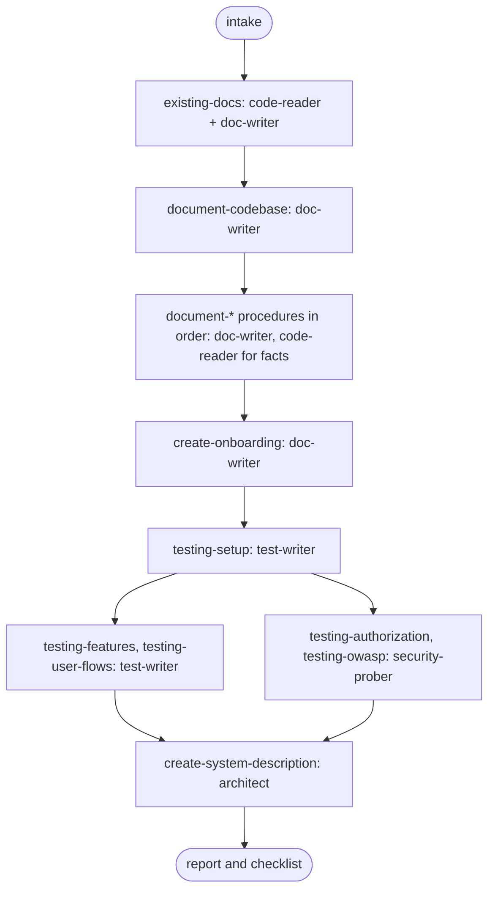

# Intake

**Arguments:** `$ARGUMENTS`

The one entry point for intake. It works `docs/intake-checklist.md` in order: for each item it starts the agent that does that kind of work on the item's procedure, settles the procedure's checkpoint (attended, the owner confirms the scope; in a goal run the agent drafts it and goes on), reviews the diff and commits. The agents write; this session decides, checks and commits. It ends with the system description.

- No argument: work the checklist from the first unchecked item without an unresolved `BLOCKED:` note, through Phase 3.
- A procedure name (`intake document-glossary`): run or rerun that one procedure. Anything after the name goes to the procedure as its options (`intake create-system-description --full`, `intake document-api backend/`).

Before the first item, read `${CLAUDE_PLUGIN_ROOT}/references/intake/rules.md`, `${CLAUDE_PLUGIN_ROOT}/references/intake/findings.md` and `${CLAUDE_PLUGIN_ROOT}/references/intake/checklist.md`. Load the `SendMessage` tool with ToolSearch (`select:SendMessage`): it is deferred, and an attended checkpoint, `document-authorization`'s second pass and a rerun for a missing skill all resume an agent with it.

`guard <command>` below means `uv run -q --no-project --python ">=3.11" "${CLAUDE_PLUGIN_ROOT}/runtime/guard.pyz" <command>`, the ticket guard bundled with this plugin. Type it out each time, or define a shell function (`guard() { uv run -q --no-project --python ">=3.11" "${CLAUDE_PLUGIN_ROOT}/runtime/guard.pyz" "$@"; }`); a variable holding the command fails in zsh, which doesn't split it into words.

## Flow



## Procedures and agents

Each procedure lives at `${CLAUDE_PLUGIN_ROOT}/references/intake/procedures/<procedure>.md` and runs in one agent. Its id in the checklist, its docs' `command:` frontmatter and its commits' `Intake:` trailer stays `intake:<procedure>`.

| Agent | Procedures |
|-------|------------|
| `fullstack-dev-skills:doc-writer` | `existing-docs`, `document-codebase`, `document-file-tree`, `document-data-model`, `document-integrations`, `document-api`, `document-user-model`, `document-features`, `document-glossary`, `document-security`, `document-authorization`, `document-user-flow`, `document-config`, `document-analytics`, `create-onboarding` |
| `fullstack-dev-skills:test-writer` | `testing-setup`, `testing-features`, `testing-user-flows` |
| `fullstack-dev-skills:security-prober` | `testing-authorization`, `testing-owasp` |
| `fullstack-dev-skills:architect` | `create-system-description` |
| `fullstack-dev-skills:code-reader` | Facts for any of the above: the blind batches of `document-authorization`'s second pass, and an area the writer's discovery would otherwise read whole (a large codebase) |

## Setup

1. When `docs/intake-checklist.md` is missing, copy the template from `references/intake/checklist.md` with the date, the branch and its start SHA filled in. Attended, show it and confirm the branch first; intake runs on its own branch (`intake/<YYYY-MM-DD>`), never the default branch.
2. Decide the mode by the table in `${CLAUDE_PLUGIN_ROOT}/references/specs/unattended.md`: goal mode under a `/goal`, attended when `AskUserQuestion` is available, otherwise the wrong-session stop.
3. Detect the stack once (the package manifest and lockfile, the framework config, the test config) and pick the matching `fullstack-dev-skills:` language and framework skills, as "Skills" in `references/intake/rules.md` describes.

## Per item

1. **Pick.** Re-read the checklist and take the item (the next unchecked one, or the named procedure). An item that names no procedure (start the findings tracker, link the docs index from `CLAUDE.md`) is done here in this session, then goes to step 7.
2. **Name the procedure and its skills.** The procedure is `${CLAUDE_PLUGIN_ROOT}/references/intake/procedures/<procedure>.md`; the agent reads it, so this session doesn't. Print only its skills list, `sed -n '/^## Skills to load/,/^## /p' <path>`, and add the stack skills that apply. Name the path in every brief for the item: the intake eval opens the item at the first brief that names it.
3. **Start the agent** with the brief below. When it needs facts from a large area, start `code-reader` agents first (they only read, so several may run at once) and pass their reports in the brief.
   - **Goal run: one pass.** The agent runs the whole procedure. At the checkpoint it puts the scope it would have shown in its report under `Checkpoint draft:`, adds an Open questions row only under the rule in `references/intake/rules.md` ("In a goal run"), and goes on to write, audit or run and verify. Nobody answers a goal-run checkpoint, so the agent never stops there.
   - **Attended: discovery, then resume.** The agent runs up to the checkpoint, returns the scope and writes nothing.
4. **Checkpoint.** Goal run: the agent's drafted note carries its `Checkpoint draft:` into the checklist. Attended: show the scope and wait for the owner to confirm or correct it.
5. **Write.** Attended, resume the same agent with `SendMessage`, giving the confirmed or corrected scope. It writes with its discovery still in context, runs the procedure's audit or run-and-verify phase, and reports. One writing agent runs at a time, except the three in "Parallel testing writers" below. When `document-authorization` returns its second-pass batches, start one fresh `code-reader` per batch with only what the procedure lists, all in one message, then resume the writer with their reports.
6. **Check the report.** Its last line lists the skills it loaded. When a skill the brief named is missing, resume the agent to load it and redo the work that needed it; when it is still missing, start a fresh agent for the item. Then review the diff yourself: `git status --short` and `git diff` show only the files under the report's `Changed files:`, and only what "What intake may change" in `references/intake/rules.md` allows. The agent ran the item's check (`guard docs-check` or the project's test command) after its last edit and put the output under `Checks:`. Rerun a check the agent ran only when the diff or the output gives a reason: the output is missing, failing or cut short, the command isn't the project's own, or the diff holds a change the run can't have covered.

   **Full suite at phase boundaries.** The agents' own checks cover their items; you run the project's full test command yourself, and read its fresh counts (the blocked count included) against what the agents reported, at four points: after `document-codebase` (the one documentation item that edits code), after `testing-setup`, after the parallel testing batch, and at the end of the run. A failure there stops the next item until it is traced to the item that caused it and fixed with a follow-up commit carrying that item's trailer.
7. **Commit.** Check the box. Paste the drafted note from the report under it (an item done in this session writes its own), correcting anything the diff or the report contradicts: the date, the evidence, the finding ids raised, the skills the agent reported loading (a skill it didn't load gets `<skill> not loaded: <reason>`), and its human-voice line for a documentation item. Commit the item's files and the checklist together with the drafted message, `<docs|test>(intake): <procedure>`, with the trailer `Intake: intake:<procedure>` (an item that names no procedure takes the trailer its checklist line names, when it names one) in the message's last paragraph, beside any other trailer (`Co-Authored-By:`) with no blank line between them: git reads trailers only from the last paragraph, so an `Intake:` line followed by a blank line and `Co-Authored-By:` is not a trailer. Check it with `git log -1 --format='%(trailers:key=Intake,valueonly)'`, and fix a wrong one with a follow-up commit, never an amend. Agents never commit.

Attended runs stop after an item when the owner says so; the checklist is the state the next run starts from.

### Read-only work in parallel

Writers run one at a time; readers never wait for them.

- Start independent `code-reader` agents in one message, so they run at once: an item's fact passes, or the batches of `document-authorization`'s second pass.
- While an item's writer runs, and while you review and commit its work, start the next item's `code-reader` fact pass: the inventory its first phase builds from the code (routes for `document-api`, models for `document-data-model`, settings for `document-config`, the units for `testing-features`), each fact cited `path::symbol`. Skip it when that code is small. Its brief says there is no procedure for it and names the area and the questions, never a procedure path and never a file the current item is writing: the intake eval opens an item's window at the first brief naming its procedure, so an early brief that names one cuts the current item's window short. Pass the report to the next writer under "Facts already gathered".
- Attended, the next item's discovery may also start early when its procedure reads none of the files the current item is writing. Show its scope to the owner once the current item is committed.
- Start the next writer only after the current item is committed: writers share the findings tracker and its ordered ids, and later docs read earlier ones. The one exception is the batch below.

### Parallel testing writers

After `testing-setup` is committed, `testing-features`, `testing-authorization` and `testing-owasp` write at once: they write separate test trees, and their write passes are a run's longest. None of them touches the tracker; this session assigns their finding ids and commits them one item at a time. `testing-user-flows` and `create-system-description` stay serial after them.

1. **Start all three in one message**, each with the brief below plus the batch lines; each brief names its own procedure path, so the intake eval attributes each agent's work to its item. Goal run: each runs in one pass. Attended: start the three discovery passes together, show the owner all three scopes at once, then resume all three with `SendMessage` in one message, each with its confirmed or corrected scope. Run them serially instead when two test runs can't share this machine (one fixed test database name or port, as `testing-setup`'s note shows).
2. **Batch lines** for each brief:
   ```
   Parallel batch: testing-features, testing-authorization and testing-owasp write at the same time in this tree. Write only your own test files (and, for testing-authorization, docs/security/authorization.md); leave shared fixtures, helpers and config alone when you can, and list any you change under Changed files.
   Don't edit docs/intake-findings.md; this overrides the procedure's tracker steps. Give each new finding a provisional id from your range (testing-features F-901 up, testing-authorization F-931 up, testing-owasp F-961 up) and use it wherever the real id would go. Under "Tracker edits:" after Checks in your item report, give each new finding in the tracker's shape, each Summary, Test coverage and Open questions row, and each changed line of an existing finding (its Tests: line, its text) as the line to replace and its replacement.
   Run only your own test files as your check.
   ```
3. **Check the batch** once all three report: each report as step 6 does, then `git status --short` against the three `Changed files:` lists together. A path in two lists is a shared file. A changed path in no list: ask the agents which wrote it, and treat it as shared when more than one did.
4. **Fall back to serial** on a shared file, since one file holding two items' edits can't be split across their commits. Keep the first item's change, in checklist order: restore the file (`git restore <path>`, or delete it when new), resume that item's agent with `SendMessage` to redo its own edit of the file and rerun its tests, and commit it as below. Discard each later item that touched the file (`git restore` its tracked files, delete its new ones), and after the items before it are committed, resume its agent to write again on top of them, as a serial item with the per-item steps. Items that touched no shared file commit as below.
5. **Assign ids** in checklist order (`testing-features`, `testing-authorization`, `testing-owasp`): give each item's provisional ids the next free F-ids in the order its report lists them, and rewrite them in its changed files and its tracker edits, both `F-901` and the hyphen-less `F901`. `git grep -nE 'F-?9[0-9]{2}'` then finds none. Run the project's test command once, fresh: each agent ran only its own files.
6. **Commit each item** in the same order, one at a time: apply its tracker edits to `docs/intake-findings.md` (appending as `references/intake/findings.md` says), check its box with its drafted note, and commit its files, the tracker and the checklist with its drafted message, as step 7 does. `testing-authorization`'s matrix update stays its own commit after its tests.

### The brief

Keep the line for the run's mode and drop the other.

```
Use the <skill> skill to <what this procedure produces>. Also load: <the other skills, each by exact name>.
Procedure: <plugin root>/references/intake/procedures/<procedure>.md. Read it and the files it names under <plugin root>/references/intake/ before anything else.
Plugin root: <the value of ${CLAUDE_PLUGIN_ROOT}>. Project root: <path>. Options: <what followed the procedure name, or none>. Mode: <attended|goal run>.
<goal run> One pass: don't stop at the procedure's checkpoint. Put the scope it shows in your report under "Checkpoint draft:", follow the goal-run rule in rules.md, and go on to write.
<attended> Discovery only: run the procedure up to its checkpoint and return the scope it shows. Write nothing until I resume you.
Facts already gathered: <code-reader reports, or none>.
Before you report, run the item's check (guard docs-check, spelled out in rules.md, for a documentation item; the project's test command for a testing item). End your report with the item report in rules.md ("The item report"), then "Skills loaded: ..." listing the skills you loaded.
```

## After the last item

Phase 4 (the gate) stays attended and outside this command. Report a table (item, commit, evidence, finding ids), any High security finding that affects the deployed system first (id and one line, no reproduction detail), then blocked items and open questions.

## Rules

- Agents write, one at a time except the parallel testing writers, and never commit. This session reviews each agent's diff and commits it.
- Agents can't ask the owner: every question goes through this session's checkpoint.
- Never edit a file an agent is writing while it runs, and never run a writing agent while a ticket marker exists (`references/intake/rules.md`).
