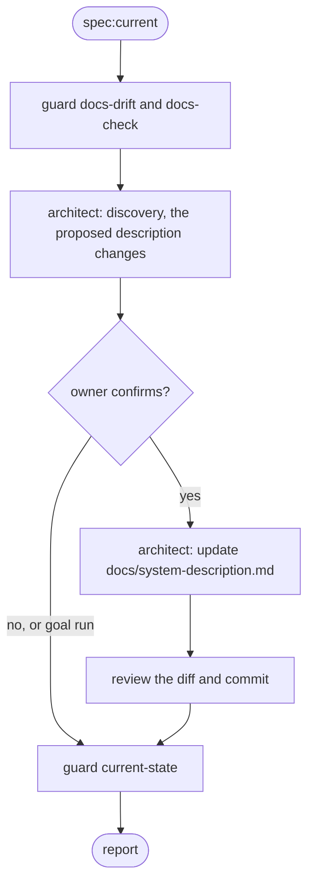

# Spec Current

What is true now. It checks the system description and the docs against the code and the completed specs, updates the description through the `architect` agent, compiles `docs/current-state.json`, and reports component status, drift and stale docs. `spec:diff` and `common-ground` read what it leaves.

`guard <command>` below means `uv run -q --no-project --python ">=3.11" "${CLAUDE_PLUGIN_ROOT}/runtime/guard.pyz" <command>`, the ticket guard bundled with this plugin. Type it out each time, or define a shell function (`guard() { uv run -q --no-project --python ">=3.11" "${CLAUDE_PLUGIN_ROOT}/runtime/guard.pyz" "$@"; }`); a variable holding the command fails in zsh, which doesn't split it into words.

## Flow



## Step 1: Read the state

1. Read `.claude/workflow-config.json` for `specsRoot` and `docsRoot` (defaults `docs/specs` and `docs`).
2. When `docs/system-description.md` is missing, stop: "No system description yet. Run `intake create-system-description` first." A project that started from discovery runs it once its first specs are completed.
3. Run `guard docs-drift` and `guard docs-check` and keep their output for the report.

## Step 2: Update the system description

Start one `fullstack-dev-skills:architect` agent in discovery mode, briefed with the procedure `${CLAUDE_PLUGIN_ROOT}/references/intake/procedures/create-system-description.md` (its rerun path: fold in the completed specs its `## Change history` doesn't list) and the drift rows from Step 1:

```
Use the fullstack-dev-skills:architecture-designer skill to check docs/system-description.md against the code and the completed specs. Also load: fullstack-dev-skills:spec-miner.
Procedure: <plugin root>/references/intake/procedures/create-system-description.md, rerun path. Plugin root: <${CLAUDE_PLUGIN_ROOT}>.
Check every row of the section 2 component table: its status (`wired`, `built, not wired`, `planned`) against the code, citing the call path that makes it wired. Drift to fold in: <guard docs-drift rows>.
Discovery only: return the section changes you would make, each with its source, and write nothing until I resume you.
End your report with "Skills loaded: ...".
```

Attended, show the proposed changes and ask the owner which to apply. Resume the agent with `SendMessage` (load it with ToolSearch, `select:SendMessage`) and the approved list; it applies them and runs the procedure's accuracy audit. Review its diff, then commit: `docs(system): fold <specs> into the system description` with the trailer `Intake: intake:create-system-description`, so `guard docs-drift` counts it as the doc's update. Under a goal, or when the owner approves nothing, change no doc and list the proposed changes in the report as pending.

## Step 3: Compile the current state

```bash
guard current-state
```

It writes `docs/current-state.json` from section 2 of the system description, the Summary table of `docs/intake-findings.md` and `guard docs-drift`, and refuses on a malformed table or an unknown status; fix the description and rerun. Never edit the JSON by hand. Commit it alone: `docs(system): compile current state`.

## Step 4: Report

```markdown
## Current state at <short HEAD>

### Components
| Component | Status | Source |

### Open findings
| ID | Finding | Severity | Status |

### Drift and stale docs
| Doc | Why | Fix |

### Pending description changes
<the proposed changes not applied, or "none">

### Next
`spec:diff` to see what the outstanding specs change, then `common-ground` to check their assumptions.
```

A doc in drift is fixed by rerunning its intake procedure (`intake <procedure>`) or by the ticket that changed its code; this command reports it and changes no doc but the system description.
