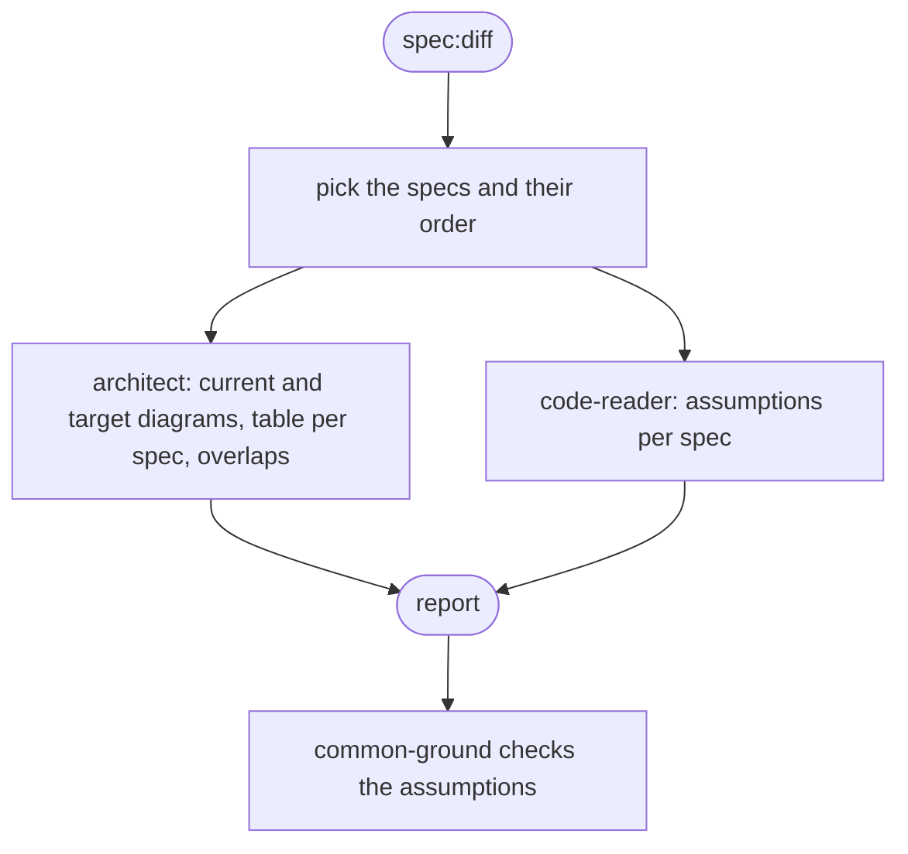

# Spec Diff

**Arguments:** `$ARGUMENTS`

Read-only. What changes if these specs land, in the given order: the current component diagram beside the target, a table per spec, the overlaps where two specs touch the same component or one assumes what another removes, and the assumptions each spec makes about the current system. It prints a plan and writes no file. `common-ground` checks the assumptions it lists.

`guard <command>` below means `uv run -q --no-project --python ">=3.11" "${CLAUDE_PLUGIN_ROOT}/runtime/guard.pyz" <command>`, the ticket guard bundled with this plugin. Type it out each time, or define a shell function (`guard() { uv run -q --no-project --python ">=3.11" "${CLAUDE_PLUGIN_ROOT}/runtime/guard.pyz" "$@"; }`); a variable holding the command fails in zsh, which doesn't split it into words.

## Flow



## Step 1: Pick the specs

1. When `docs/system-description.md` is missing, stop: "No system description yet. Run `spec:current` first, or `intake create-system-description` when it has never run."
2. Spec names in `$ARGUMENTS`, in that order. With none, every outstanding spec from `guard spec-status` (any state but Completed: `Unbranched` (any branch), Triaged, Drafting, Planned, In progress, Ready for review, In review, Ready to complete, PR open; match `Unbranched` by its prefix, since the state reads `Unbranched (on <branch>)`), in its order. Refuse a name that isn't outstanding, listing the ones that are.
3. Read `docs/current-state.json` when it exists. When its `built_at.system_description` doesn't match the description's `Last updated` SHA, say the state is stale and suggest `spec:current`; continue with the description.

## Step 2: Build the views

Start these two agents in one message so they run together; both only read and write nothing.

- One `fullstack-dev-skills:architect` agent:

  ```
  Use the fullstack-dev-skills:architecture-designer skill to show what changes if these specs land in this order: <specs>.
  Read docs/system-description.md (section 2 components, section 3 data flow), docs/current-state.json when present, and each spec's overview.md and implementation-plan.md under <specsRoot>/todo/<spec>/.
  Return, writing no file: the section 2 component diagram unchanged as Current; a Target diagram once every spec lands, adding, changing or removing only what an overview says, each changed node labeled with its spec; per spec a table of the components and flows it adds, changes or removes, citing its overview; and the overlaps: two specs touching one component, or one spec removing or changing what a later one relies on.
  End your report with "Skills loaded: ...".
  ```

- One `fullstack-dev-skills:code-reader` agent with `${CLAUDE_PLUGIN_ROOT}/references/specs/assumptions.md` and the same specs in the same order, asked for the assumption list that reference defines. It writes nothing.

Rerun an agent whose "Skills loaded" line lacks the skill its brief named.

## Step 3: Report

```markdown
## Spec diff: <spec>, <spec>, ... (in this order)

> A plan, not the current state. Built at <short HEAD> from the specs' overviews. `docs/system-description.md` describes the system as built.

### Current
<Mermaid component diagram from section 2, unchanged>

### Target
<Mermaid diagram once every listed spec lands; changed nodes labeled with the spec>

### <spec>
| Adds, changes or removes | Component or flow | Source |

### Overlaps
| Specs | Component or assumption | What collides |

### Assumptions
<the table from references/specs/assumptions.md>

### Next
`common-ground <specs>` checks these assumptions against the current state.
```

## Rules

- Write nothing: no file, no commit, no tracker call. It runs the same attended or under a goal.
- Never present a target node as built, and never copy a claim from this report into the system description or another doc.
