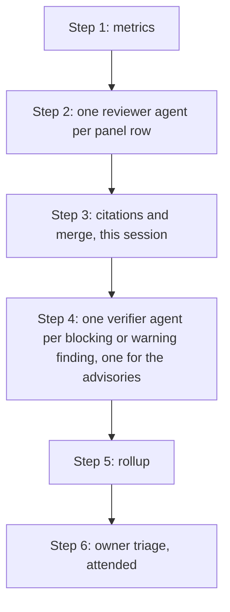

# Spec Review

Review a finished spec branch once, over its whole diff, before `spec:complete` opens the PR. A panel of `reviewer` agents writes findings; one blind `verifier` agent per finding decides whether each is real; a script builds the rollup; the owner picks what to fix; fix tickets join the plan and run through `ticket:execute`. Rerun it after the fixes for the recheck.


`guard <command>` below means `uv run -q --no-project --python ">=3.11" "${CLAUDE_PLUGIN_ROOT}/runtime/guard.pyz" <command>`, the ticket guard bundled with this plugin. Type it out each time, or define a shell function (`guard() { uv run -q --no-project --python ">=3.11" "${CLAUDE_PLUGIN_ROOT}/runtime/guard.pyz" "$@"; }`); a variable holding the command fails in zsh, which doesn't split it into words.

## Unattended guard

The panel and verifiers can run in any session, but the owner triage (Step 6) is attended only. Read `${CLAUDE_PLUGIN_ROOT}/references/specs/unattended.md`. When a goal is active, stop after Step 5, record no decisions and add no fix tickets, and end with `BLOCKED: spec:review triage needs the owner`. When `AskUserQuestion` is unavailable and no goal is active, stop after Step 5 the same way, through that file's wrong-session stop.

## Step 0: Start clean

1. Check out `spec/<spec-name>` and read the spec's plan. Every ticket must be Done or Blocked; otherwise point to the goal run and stop.
2. Commit Blocked rows a goal run left in the plan:

   ```bash
   guard commit-plan <spec-name>
   ```

3. The working tree must be clean. Record `head_sha=$(git rev-parse HEAD)`.

## Step 1: Metrics

```bash
guard metrics <spec-name> --json
```

It writes `review/metrics.md` for the files changed since the merge base (duplication, dead code, complexity, with the tools it found). Reviewers read it. The JSON it prints gives `path`, `tools` (each tool as `ran`, `missing` or `no-files`), `ran` and `missing`.

A tool in `missing` had changed files to read but is not installed, so its check did not run. It exits 3 when code changed and no such tool was installed at all; stderr and `metrics.md` then say `No metric tool ran (not installed: ...)`, or `Not installed, so unmeasured: ...` when some tools ran. A check that did not run proves nothing, clean or not. When it exits 3 or `missing` is not empty, warn the owner before the panel starts, about each missing tool:

- Attended: show each missing tool, what it finds and its install hint (from its `did not run` line in `metrics.md`), and ask with `AskUserQuestion` whether to continue without it or stop so the owner can install it and rerun `guard metrics <spec-name> --json`.
- In goal mode: continue, and list each missing tool first in the turn's final report.

Either way, tell the `code-reviewer` in its brief which checks did not run (the `missing` tools), so it never reads a missing section as no findings.

When the docs root holds docs, also save the docs state for the `code-documenter` reviewer:

```bash
guard docs-affected --base <merge-base> > <specsRoot>/todo/<spec-name>/review/docs.md
guard docs-check >> <specsRoot>/todo/<spec-name>/review/docs.md 2>&1
guard docs-waivers <spec-name>
```

`review/docs.md` lists each affected doc: one that cites changed code or is `related:` to an affected doc, and every doc the diff adds or changes, listed as `updated` with the reason `added in the diff` or `changed in the diff`. `docs-waivers` writes `review/docs-waivers.md`: every doc a ticket recorded as "checked, no change" and every doc the spec changed by three words or fewer. A goal run may record a waiver, so it never decides alone: the `code-documenter` reviewer rules on each row, and `guard gate` refuses while a row has no ruling.

## Step 2: Panel

Pick reviewers from what the diff touches:

| When | Reviewer skill | Focus |
|------|----------------|-------|
| Always | `code-reviewer` | Broad review, plus duplication, dead code and debt from `metrics.md` |
| Docs under the docs root | `code-documenter` | Each affected doc in `review/docs.md` against the diff, the `updated` docs the diff added or changed included: claims the code no longer bears out, `path::symbol` citations that no longer resolve, a fact repeated in two docs instead of linked, one-sided `related:` links, a doc left `pending`. Rules on every row of `review/docs-waivers.md` in a `## Waivers` table in its file: `| W<n> | holds | - |`, or `| W<n> | wrong | <finding id> |` with that finding raised as blocking |
| Always | `test-master` | Acceptance criteria traced to tests, test quality, proof for removed or merged tests, plus the tamper-scan flags from the Completion Status notes |
| Auth, sensitive data, dependencies | `security-reviewer` | Security defects |
| System structure, contracts | `architecture-designer` | Structural defects |
| Routes, schemas, public interfaces | `api-designer` | API design |
| Auth, crypto, input handling | `secure-code-guardian` | Secure implementation |
| The stack's own code | The stack skill from the plan's `Skill:` lines | Framework-specific defects |



Start one `fullstack-dev-skills:reviewer` agent per row, naming the row's skill in its brief. Reviewers only read and write their own file: start every reviewer in one message so they run together. Give each reviewer the spec's overview, the diff **without commit messages** (`git diff <merge-base>..HEAD`, never `git log -p`), and the repository at `head_sha`. Strip PR text and ticket status blocks. Brief:

```
Use the fullstack-dev-skills:<skill> skill to review this diff for defects in your area.
Read: <specsRoot>/todo/<spec-name>/overview.md, review/metrics.md, the diff below, and the code at <head_sha>.
Write only review/<reviewer>.md: one row per finding with tier (blocking | warning | advisory), file, line range, quoted code, head_sha, claim (one falsifiable defect) and failure scenario. No fixes.
End your report with the skills you loaded.
```

Each reviewer writes only its own file, `review/<reviewer>.md`, named after its skill (`review/code-documenter.md`, `review/test-master.md`); nothing else writes there. When a reviewer's report doesn't list the skill its brief named, rerun it.

## Step 3: Check citations and merge duplicates

In this session: check each finding's file, line range and quote against `head_sha`. A finding that fails is `invalid` and skips verification, except blockers, which are still verified. Merge findings only when the same root cause and the same fix cover both; keep every source and the highest tier. Number the merged findings F1, F2, ...

## Step 4: Verify

Follow `${CLAUDE_PLUGIN_ROOT}/references/review/verifier.md`: one fresh `fullstack-dev-skills:verifier` agent, briefed with the `debugging-wizard` skill, per merged blocking or warning finding, limited to Reproduce, Isolate and Hypothesize; the advisories in one read-only batch; one second look for a rejected blocker. Each verifier works in its own scratch worktree at `head_sha` (`git worktree add --detach`), with no gitignored files, and gets a packet holding the claim, location, quoted code, failure scenario and the ticket's acceptance criteria, never the reviewer's name, tier or reasoning, other findings or commit messages. Start the verifiers in one message so they run together, then wait for their notifications; never schedule a fallback (no `ScheduleWakeup`, `CronCreate`, `RemoteTrigger` or `/loop`, not even in case a verifier never reports back), as "No self-scheduling" in `${CLAUDE_PLUGIN_ROOT}/references/specs/unattended.md` says. A worktree doesn't separate a shared database or fixed ports, so verifiers whose reproductions use them run one at a time.

Before copying, read each reproduction and verdict for environment dumps, tokens, keys, socket paths and session ids, and cut them (a verifier once captured a whole `strace -v` environment). Copy each reproduction into `review/repro/` with its sha256, then remove the worktrees. There is no budget cap; cost is recorded instead.

## Step 5: Rollup

Write the verdicts to `review/verdicts.jsonl` in the format in `${CLAUDE_PLUGIN_ROOT}/references/review/rollup.md` as JSON lines (`id`, `tier`, `suggested`, `sources`, `location`, `claim`, `verdict`, `proof`, `evidence`, `reason`, `status`, `agent_id`), then:

```bash
guard rollup <spec-name> --verdicts review/verdicts.jsonl --transcripts ~/.claude/projects/<project>/<session-id>/subagents/
```

Add one `--transcripts` folder per session that ran verifiers (a recheck spans sessions). `review/rollup.md` lists every finding, including `invalid` and `rejected` ones, with tokens and minutes per verifier. Commit `review/`: `docs(<spec-name>): spec review`.

## Step 6: Owner triage

Attended only. Show the rollup, blocking rows first. For each confirmed or unresolved blocking and warning row, ask the owner with `AskUserQuestion`: fix (typed behavior or refactor), won't fix, or accept a rejection. Record owner statuses only through the runtime, never by editing markdown:

```bash
guard decide <F-id> wontfix --spec <spec-name>
guard decide <F-id> rejection-accepted --spec <spec-name>
guard decide <F-id> revoke --spec <spec-name>
```

`revoke` withdraws a row's recorded decision. The newest record per row wins, so a revoked row has no owner decision: the rollup shows its verifier status again and the gate judges it afresh, until a later `decide` replaces the revoke. When the owner turns a row already recorded as `wontfix` or `rejection-accepted` into a fix ticket, revoke that row first, rebuild the rollup with the Step 5 `guard rollup` command, and export the decisions again below.

After the last decision, run `guard decisions export <spec-name>`. It writes the spec's full decision history, revokes included, to `review/decisions.jsonl` for git history, and another clone imports them from there with `guard decisions import <spec-name>`. The gate never reads that file. Commit it with the fix round below, or alone as `docs(<spec-name>): owner decisions` when there are no fixes.

For each fix, add a Pending fix ticket (`<spec-name>-rv-<n>`) to the plan's Completion Status, Execution Order and Tickets, with acceptance criteria in your own words, the frozen reproduction in `review/repro/` named as evidence, and a type from `${CLAUDE_PLUGIN_ROOT}/references/review/verifier.md`: `test` (a defect: its own RED test adapted to the suite), `test-gap` (correct code, missing test: RED is the new test against the verifier's frozen mutant), `stand-in` (docs or configuration) or `refactor` (suite green before and after, test files unchanged by digest, metrics show the target gone). Add no `refactor` ticket whose proving tool is in Step 1's `missing` list, a check that did not run (`jscpd` for duplication, `vulture` or `knip` for dead code, `lizard` for complexity): nothing could show the target gone. Tell the owner, who installs the tool and reruns `guard metrics`, or picks another type or won't fix. A fix that delivers a Blocked ticket's work says `Delivers: <ticket>`. Then write a fresh `goal-prompt.md` for the fix tickets from `${CLAUDE_PLUGIN_ROOT}/references/specs/templates/goal-prompt.md`, marking each check a fix ticket creates `(needs <ticket> Done)`, and commit the plan, the prompt and `review/decisions.jsonl` together; that commit is the fix round's start SHA. Print the launch commands from `${CLAUDE_PLUGIN_ROOT}/references/specs/launch.md`, and tell the owner to run the next `spec:review` triage in a fresh session without the goal flags.

## Recheck

After the fix tickets are Done, rerun `spec:review <spec-name>`. With a rollup present it runs the recheck in `${CLAUDE_PLUGIN_ROOT}/references/review/verifier.md` instead of a new panel: a fresh verifier with no triage history reruns each frozen reproduction at the fix commit's parent (it must fail) and at the fix (it must pass), with an adapted copy beside it when the frozen file can't tell the two apart, searches the spec diff for the same mistake, re-verifies rejected or unresolved rows whose lines changed, and the full suite runs in a clean worktree (`guard rerun --spec <spec-name>`). Update the rollup statuses (`fixed-verified`, `reopened`). After three rounds on one finding, ask the owner to reconsider the approach. After the third recheck round that raised a new blocking row, write no fix tickets: ask the owner to fix and continue, accept, split off or rethink, as "Rounds per spec" in `verifier.md` describes. The owner can ask for a full panel rerun at any time. As in Step 4, wait for the recheck verifiers' notifications; never schedule a fallback. A verifier that never reports back is reported to the owner, who reruns `spec:review`.

## Next

When `guard gate <spec-name>` would pass, run `spec:complete <spec-name>`.
